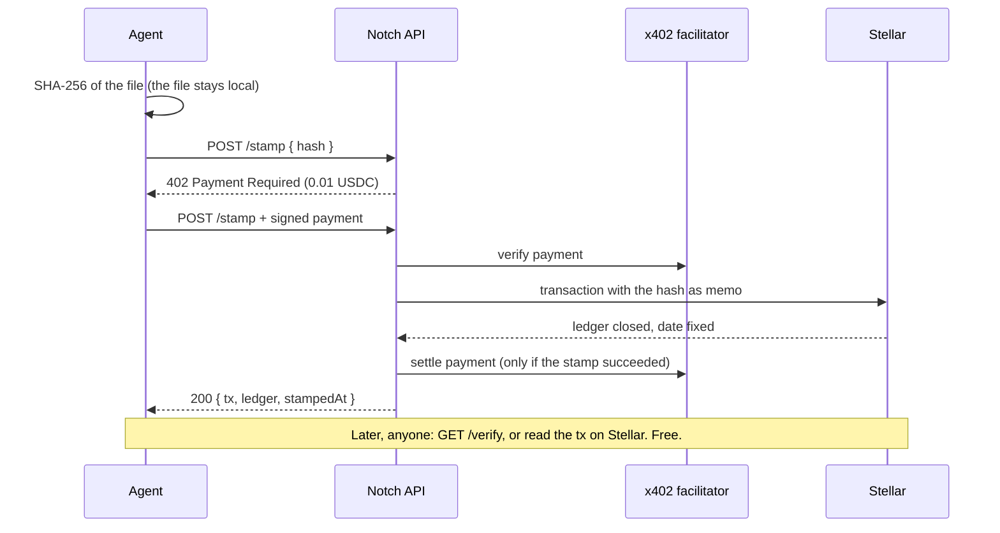
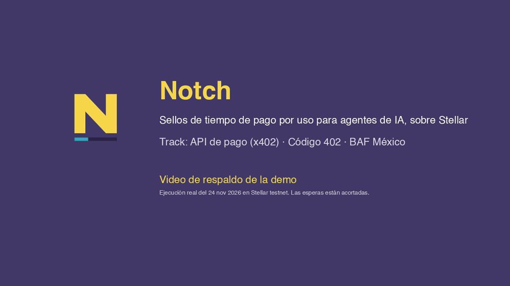

<p align="center">
  
</p>

[Español](README.md) | English

# Notch

[](https://github.com/josecadenax/notch/actions/workflows/test.yml)

**Pay-per-use timestamps for AI agents, on Stellar.**

An agent hashes what it produced, pays 0.01 USDC with x402, and Notch anchors that hash in a Stellar transaction. From then on, anyone can prove for free that the document existed no later than that date.

**Track:** API de pago (x402) · Código 402 · BAF México × Programa de Embajadores de Stellar · Stellar testnet (test money, no real value)

## The problem

Agents now write reports, contracts and datasets, and often get paid for them. When someone asks "was this written before the deadline?" or "was it changed afterwards?", the only evidence is the agent's own logs, which the same party controls.

An agent also has no account, no credit card and no contract with a timestamp provider. What it can do is pay one cent per call, which is why Notch charges with x402: no sign-up, no API key and no subscription.

## How Notch solves it



- **Only the hash travels.** The document never leaves the machine.
- **The date is Stellar's**, the close time of the ledger, not the server's clock.
- **Verification is free** and does not need Notch: the memo of the transaction can be read on any explorer.
- **You pay only for stamps that exist.** A failed stamp is never charged.

## Try it now

The API is deployed on Stellar testnet: **https://notch-production-721b582b.up.railway.app**

```
curl https://notch-production-721b582b.up.railway.app/
curl -i -X POST https://notch-production-721b582b.up.railway.app/stamp -H 'content-type: application/json' \
  -d '{"hash":"aaaaaaaaaaaaaaaaaaaaaaaaaaaaaaaaaaaaaaaaaaaaaaaaaaaaaaaaaaaaaaaa"}' | head -1
```

The second call answers `402 Payment Required`: no payment, no stamp. Verifying a real stamp is free:

```
curl "https://notch-production-721b582b.up.railway.app/verify?hash=20ef27f25fd5ca7a2ae2c8b7447058cb317a0cc576fd4b25750281a909353de9&tx=16e1df0c10c019c7b8f9235f27e8e1282968f2fdb835778668c878b06d27a80d"
```

It answers `"valid": true` with the ledger date. The [stamp transaction](https://stellar.expert/explorer/testnet/tx/16e1df0c10c019c7b8f9235f27e8e1282968f2fdb835778668c878b06d27a80d) can be opened in Stellar Expert.

## Use it from Claude Desktop (MCP)

Notch ships a local MCP server. Claude Desktop starts it on your computer and stamps or verifies files for you, paying against the public API.

| Tool | Cost | What it does |
|---|---|---|
| `stamp_file` | 0.01 USDC | Hashes locally, pays with x402 and anchors the stamp |
| `verify_stamp` | free | Checks a file against its stamp, straight on Stellar |
| `check_balance` | free | Shows your wallet, its balance and how many stamps are left |

```
npm install
npm run setup:accounts -- --agent-only   # creates your testnet wallet in .env.agent
```

Then add `notch` to Claude Desktop's config. The steps are in [docs/mcp.md](docs/mcp.md).

**The paying wallet is yours.** It is created on your machine, its key never reaches the server, and the client only pays the account it has pinned (`EXPECTED_PAYEE`), so a fake API cannot charge you. Use a dedicated wallet with a small balance.

## Demo video



A 1:23 animation built from the real output of a run on Stellar testnet, with the waits shortened. The hashes shown can be opened in Stellar Expert. [Download the video (mp4)](https://github.com/josecadenax/notch/raw/main/docs/assets/demo/notch-demo-backup.mp4).

## How to run it

Needs Node 22 or newer. The code lives in [`partes/josecadenax`](partes/josecadenax/README.md).

```
npm install
npm run setup:accounts           # testnet accounts, keys saved in .env
npm start                        # API on http://localhost:3001
npm run stamp -- file.pdf        # another terminal: hash, pay and stamp
npm run verify -- file.pdf <tx>  # check a file against a stamp
npm test                         # 57 tests
```

To stamp against the public API instead of your local server, create your wallet with `npm run setup:accounts -- --agent-only`, copy its `AGENT_SECRET` into `.env` and run:

```
API_URL=https://notch-production-721b582b.up.railway.app npm run stamp -- file.pdf
```

## Documentation

- [Architecture](docs/architecture.md): pieces, API contract, what is on chain, errors and charges.
- [Demo guide](docs/demo.md): the 5-minute script and the exact commands.
- [MCP server](docs/mcp.md): how to use Notch from Claude Desktop, the agent wallet and the safety rules.
- [Deployment](docs/deploy.md): how to publish your own server (Railway), which secrets are needed and where they live.

## Test hashes

A real run on Stellar testnet:

- Payment of 0.01 USDC (x402): [`15ae64c6…43bd`](https://stellar.expert/explorer/testnet/tx/15ae64c6e6a6bca9ae3775ca4971f0d5f7d6d89dfcd6ec9c2ceadd778e2743bd)
- Stamp, with the file hash in its memo: [`980e4423…1bc0`](https://stellar.expert/explorer/testnet/tx/980e4423e8a7476d899aed94d7d4220f5071ee45bdaa939a0f7c04a76cfc1bc0)

A stamp made against the public API (deployed on Railway): [`16e1df0c…a80d`](https://stellar.expert/explorer/testnet/tx/16e1df0c10c019c7b8f9235f27e8e1282968f2fdb835778668c878b06d27a80d)

## Current limits

- **Testnet only.** The money is test money. For mainnet, each user would use their own funded wallet, with the spending cap the client already enforces. Enforcing that limit in the account itself (for example with smart accounts) would be a future improvement, not a requirement.
- **The paying wallet depends on the user.** Notch never creates or holds it: the server only charges and stamps.
- **A single server instance**, because stamps are signed in a queue using Stellar sequence numbers.

## Team and parts

- [josecadenax](https://github.com/josecadenax): [their part](partes/josecadenax/README.md)
