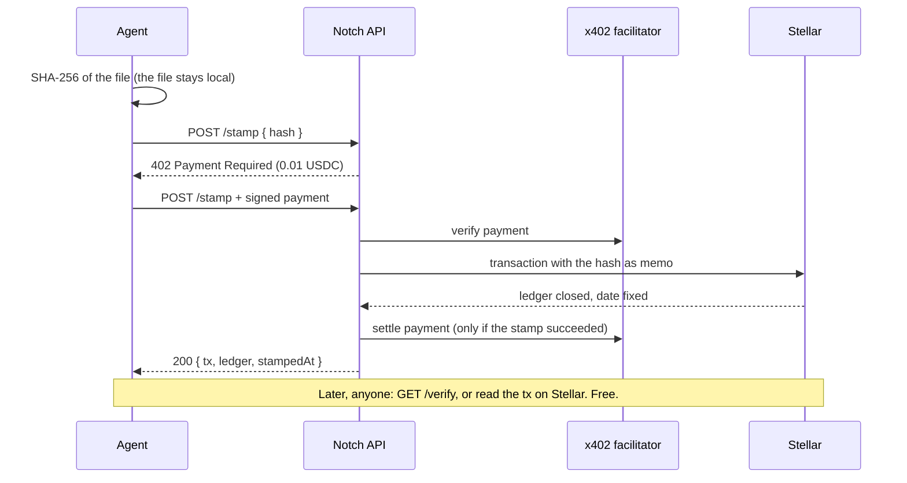

<p align="center">
  
</p>

[Español](README.md) | English

# Notch

[](https://github.com/josecadenax/notch/actions/workflows/test.yml)
[](https://notch-production-721b582b.up.railway.app)
[](https://zestful-mercy-production-31bdd567.up.railway.app)
[](LICENSE)

More and more, AI agents produce documents with real value: reports, contracts, datasets. But when someone asks "did this document already exist before the deadline?" or "was it changed afterwards?", there is no independent way to check. The only evidence is the logs of whoever produced it.

**Notch solves that problem.** It is a service that records when a document existed. The agent sends the file's digital fingerprint (a unique code called a hash; the file never leaves its machine), Notch records it on the Stellar network and, from then on, anyone can check for free that the document existed no later than that date and has not changed.

An agent has no account or credit card with a provider, so Notch charges per use: one cent of a dollar per stamp, with x402, a standard for pay-per-use payments. There is no sign-up with Notch, no API key and no subscription. All the agent needs is **its own Stellar wallet with some USDC**, which pays each stamp directly from its machine. Notch never creates the wallet or holds its key.

**Status:** it works on Stellar testnet (test money) and on mainnet (real money).

## Notch in three steps

1. **The agent computes the file's fingerprint** (the hash). The file never leaves its machine.
2. **It pays 0.01 USDC with x402, from its own wallet.** There is no sign-up with Notch.
3. **Notch records the fingerprint on Stellar** (in the *memo*, the text field of a transaction) and returns the proof. Afterwards, anyone can verify it for free.

## See it working


A 1:23 animation built from the real output of a run on Stellar testnet, with the waits shortened. The hashes shown can be opened in Stellar Expert. [Download the video (mp4)](https://github.com/josecadenax/notch/raw/main/docs/assets/demo/notch-demo-backup.mp4).

## How Notch solves it



- **Only the hash travels.** The document never leaves the machine.
- **The date is Stellar's**, the close time of the ledger, not the server's clock.
- **Verification is free** and does not need Notch: the memo of the transaction can be read on any explorer.
- **You pay only for stamps that exist.** A failed stamp is never charged.

## Why it is called Notch

A *notch* is the small cut that used to be made in a stick or a piece of wood to keep a record of something. It is the oldest way of keeping a record, and it has the properties we want: the mark is permanent, it proves that something was there, it does not say what it was, and tampering with it shows. Notch does the same with a document: it cuts a notch in Stellar with its fingerprint, without revealing the file.

## Try it now

The API is deployed on Stellar testnet: **https://notch-production-721b582b.up.railway.app**

```
curl https://notch-production-721b582b.up.railway.app/
curl -i -X POST https://notch-production-721b582b.up.railway.app/stamp -H 'content-type: application/json' \
  -d '{"hash":"aaaaaaaaaaaaaaaaaaaaaaaaaaaaaaaaaaaaaaaaaaaaaaaaaaaaaaaaaaaaaaaa"}' | head -1
```

The second call answers `402 Payment Required`: no payment, no stamp. Verifying a real stamp is free:

```
curl "https://notch-production-721b582b.up.railway.app/verify?hash=20ef27f25fd5ca7a2ae2c8b7447058cb317a0cc576fd4b25750281a909353de9&tx=16e1df0c10c019c7b8f9235f27e8e1282968f2fdb835778668c878b06d27a80d"
```

It answers `"valid": true` with the ledger date. The [stamp transaction](https://stellar.expert/explorer/testnet/tx/16e1df0c10c019c7b8f9235f27e8e1282968f2fdb835778668c878b06d27a80d) can be opened in Stellar Expert.

## Use it from Claude Desktop (MCP)

Notch ships a local MCP server. Claude Desktop starts it on your computer and stamps or verifies files for you, paying against the public API.

| Tool | Cost | What it does |
|---|---|---|
| `stamp_file` | 0.01 USDC | Hashes locally, pays with x402 and anchors the stamp |
| `verify_stamp` | free | Checks a file against its stamp, straight on Stellar |
| `check_balance` | free | Shows your wallet, its balance and how many stamps are left |

It is published on npm as [`notch-mcp`](https://www.npmjs.com/package/notch-mcp), so there is nothing to clone. Add it to Claude Desktop's config with `npx`:

```json
"notch-testnet": {
  "command": "/absolute/path/to/npx",
  "args": ["-y", "notch-mcp"],
  "env": { "AGENT_SECRET": "S...your wallet secret..." }
}
```

The full steps, how to get a wallet and how to switch to mainnet are in [docs/mcp.md](docs/mcp.md).

**The paying wallet is yours.** It is created on your machine, its key never reaches the server, and the client only pays the account it has pinned (`EXPECTED_PAYEE`), so a fake API cannot charge you. Use a dedicated wallet with a small balance.

## How to run it

Needs Node 22 or newer. The code lives in [`partes/josecadenax`](partes/josecadenax/README.md).

```
npm install
npm run setup:accounts           # testnet accounts, keys saved in .env
npm start                        # API on http://localhost:3001
npm run stamp -- file.pdf        # another terminal: hash, pay and stamp
npm run verify -- file.pdf <tx>  # check a file against a stamp
npm test                         # 86 tests
```

To stamp against the public API instead of your local server, create your wallet with `npm run setup:accounts -- --agent-only`, copy its `AGENT_SECRET` into `.env` and run:

```
API_URL=https://notch-production-721b582b.up.railway.app npm run stamp -- file.pdf
```

## Documentation

- [Architecture](docs/architecture.md): pieces, API contract, what is on chain, errors and charges.
- [Demo guide](docs/demo.md): the 5-minute script and the exact commands.
- [MCP server](docs/mcp.md): how to use Notch from Claude Desktop, the agent wallet and the safety rules.
- [Deployment](docs/deploy.md): how to publish your own server (Railway), which secrets are needed and where they live.
- [x402 facilitator](docs/facilitator.md): how to try the OpenZeppelin facilitator on testnet and measure its daily limit.
- [Mainnet](docs/mainnet.md): what the code already protects, what is missing and the step-by-step plan for real money.

## Test hashes

A real run on Stellar testnet:

- Payment of 0.01 USDC (x402): [`15ae64c6…43bd`](https://stellar.expert/explorer/testnet/tx/15ae64c6e6a6bca9ae3775ca4971f0d5f7d6d89dfcd6ec9c2ceadd778e2743bd)
- Stamp, with the file hash in its memo: [`980e4423…1bc0`](https://stellar.expert/explorer/testnet/tx/980e4423e8a7476d899aed94d7d4220f5071ee45bdaa939a0f7c04a76cfc1bc0)

A stamp made against the public API (deployed on Railway): [`16e1df0c…a80d`](https://stellar.expert/explorer/testnet/tx/16e1df0c10c019c7b8f9235f27e8e1282968f2fdb835778668c878b06d27a80d)

## Current limits

- **Testnet and mainnet.** The public API above runs on testnet (test money). There is also a mainnet API with real money, already tried with real stamps: its addresses and how to use it are in [docs/mainnet.md](docs/mainnet.md). On both, each user uses their own funded wallet, with the spending cap the client already enforces. Enforcing that limit in the account itself (for example with smart accounts) would be a future improvement, not a requirement.
- **The paying wallet depends on the user.** Notch never creates or holds it: the server only charges and stamps.
- **A single server instance**, because stamps are signed in a queue using Stellar sequence numbers.

## Team and parts

- [josecadenax](https://github.com/josecadenax): [their part](partes/josecadenax/README.md)

## Project context

**Track:** API de pago (x402) · Código 402 · BAF México × Programa de Embajadores de Stellar · Stellar testnet and mainnet
