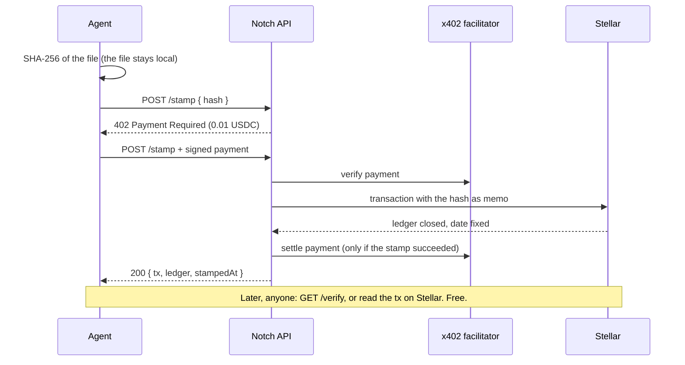

<p align="center">
  
</p>

[Español](README.md) | English

# Notch

[](https://github.com/josecadenax/notch/actions/workflows/test.yml)

**Pay-per-use timestamps for AI agents, on Stellar.**

An agent hashes what it produced, pays 0.01 USDC with x402, and Notch anchors that hash in a Stellar transaction. From then on, anyone can prove for free that the document existed no later than that date.

**Track:** API de pago (x402) · Código 402 · BAF México × Programa de Embajadores de Stellar · Stellar testnet (test money, no real value)

## The problem

Agents now write reports, contracts and datasets, and often get paid for them. When someone asks "was this written before the deadline?" or "was it changed afterwards?", the only evidence is the agent's own logs, which the same party controls.

An agent also has no account, no credit card and no contract with a timestamp provider. What it can do is pay one cent per call, which is why Notch charges with x402: no sign-up, no API key and no subscription.

## How Notch solves it



- **Only the hash travels.** The document never leaves the machine.
- **The date is Stellar's**, the close time of the ledger, not the server's clock.
- **Verification is free** and does not need Notch: the memo of the transaction can be read on any explorer.
- **You pay only for stamps that exist.** A failed stamp is never charged.

## Demo video

[](https://github.com/josecadenax/notch/blob/main/docs/assets/demo/notch-demo-backup.mp4)

Click the image to watch the video (1:23, no audio). It is an animation built from the real output of a run on Stellar testnet, with the waits shortened. The hashes shown can be opened in Stellar Expert.

## How to run it

Needs Node 22 or newer. The code lives in [`partes/josecadenax`](partes/josecadenax/README.md).

```
npm install
npm run setup:accounts           # testnet accounts, keys saved in .env
npm start                        # API on http://localhost:3001
npm run stamp -- file.pdf        # another terminal: hash, pay and stamp
npm run verify -- file.pdf <tx>  # check a file against a stamp
npm test                         # 21 tests
```

## Documentation

- [Architecture](docs/architecture.md): pieces, API contract, what is on chain, errors and charges.
- [Demo guide](docs/demo.md): the 3-minute script and the exact commands.

## Test hashes

A real run on Stellar testnet:

- Payment of 0.01 USDC (x402): [`15ae64c6…43bd`](https://stellar.expert/explorer/testnet/tx/15ae64c6e6a6bca9ae3775ca4971f0d5f7d6d89dfcd6ec9c2ceadd778e2743bd)
- Stamp, with the file hash in its memo: [`980e4423…1bc0`](https://stellar.expert/explorer/testnet/tx/980e4423e8a7476d899aed94d7d4220f5071ee45bdaa939a0f7c04a76cfc1bc0)

## Team and parts

- [josecadenax](https://github.com/josecadenax): [their part](partes/josecadenax/README.md)
