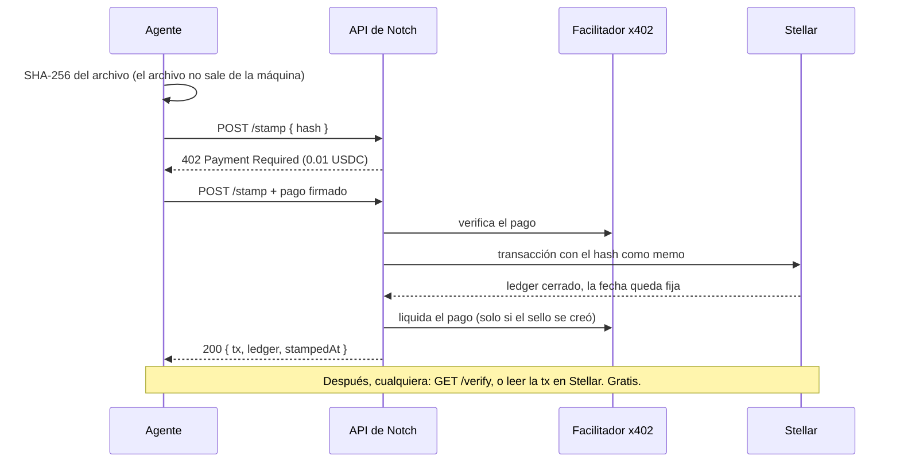

<p align="center">
  
</p>

Español | [English](README.en.md)

# Notch

[](https://github.com/josecadenax/notch/actions/workflows/test.yml)
[](https://notch-production-721b582b.up.railway.app)
[](LICENSE)
[](package.json)
[](https://stellar.expert/explorer/testnet)
[](https://www.x402.org)
[](docs/mcp.md)

**Sellos de tiempo de pago por uso para agentes de IA, sobre Stellar.**

Un agente calcula el hash de lo que produjo, paga 0.01 USDC con x402, y Notch ancla ese hash en una transacción de Stellar. Desde ese momento, cualquiera puede comprobar gratis que el documento existía a más tardar en esa fecha.

**Track:** API de pago (x402) · Código 402 · BAF México × Programa de Embajadores de Stellar · Stellar testnet (dinero de prueba, sin valor real)

## El problema

Los agentes ya escriben informes, contratos y conjuntos de datos, y a veces cobran por ellos. Cuando alguien pregunta "¿esto existía antes de la fecha límite?" o "¿se modificó después?", la única evidencia son los registros del propio agente, que controla la misma parte.

Un agente además no tiene cuenta, tarjeta ni contrato con un proveedor de sellos de tiempo. Lo que sí puede hacer es pagar un centavo por llamada, y por eso Notch cobra con x402: sin registro, sin llave de API y sin suscripción.

## Cómo lo resuelve Notch



- **Solo viaja el hash.** El documento nunca sale de la máquina.
- **La fecha es la de Stellar**, la hora de cierre del ledger, no el reloj del servidor.
- **Verificar es gratis** y no requiere a Notch: el memo de la transacción se lee en cualquier explorador.
- **Solo pagas por sellos que existen.** Un sello fallido nunca se cobra.

## Pruébalo ahora

La API está desplegada en Stellar testnet: **https://notch-production-721b582b.up.railway.app**

```
curl https://notch-production-721b582b.up.railway.app/
curl -i -X POST https://notch-production-721b582b.up.railway.app/stamp -H 'content-type: application/json' \
  -d '{"hash":"aaaaaaaaaaaaaaaaaaaaaaaaaaaaaaaaaaaaaaaaaaaaaaaaaaaaaaaaaaaaaaaa"}' | head -1
```

La segunda llamada responde `402 Payment Required`: sin pago no hay sello. Verificar un sello real es gratis:

```
curl "https://notch-production-721b582b.up.railway.app/verify?hash=20ef27f25fd5ca7a2ae2c8b7447058cb317a0cc576fd4b25750281a909353de9&tx=16e1df0c10c019c7b8f9235f27e8e1282968f2fdb835778668c878b06d27a80d"
```

Responde `"valid": true` con la fecha del ledger. La [transacción del sello](https://stellar.expert/explorer/testnet/tx/16e1df0c10c019c7b8f9235f27e8e1282968f2fdb835778668c878b06d27a80d) se puede abrir en Stellar Expert.

## Úsalo desde Claude Desktop (MCP)

Notch incluye un servidor MCP local. Claude Desktop lo arranca en tu computadora y sella o verifica archivos por ti, pagando contra la API pública.

| Herramienta | Costo | Qué hace |
|---|---|---|
| `stamp_file` | 0.01 USDC | Calcula el hash local, paga con x402 y ancla el sello |
| `verify_stamp` | gratis | Comprueba un archivo contra su sello, directo en Stellar |
| `check_balance` | gratis | Muestra tu cartera, el saldo y cuántos sellos te quedan |

```
npm install
npm run setup:accounts -- --agent-only   # crea tu cartera de testnet en .env.agent
```

Después se añade `notch` a la configuración de Claude Desktop. Los pasos están en [docs/mcp.md](docs/mcp.md).

**La cartera que paga es tuya.** Se crea en tu máquina, su llave nunca llega al servidor, y el cliente solo paga a la cuenta que tiene fijada (`EXPECTED_PAYEE`), así que una API falsa no puede cobrarte. Usa una cartera dedicada con poco saldo.

## Demo en video


Animación de 1:23 hecha con la salida real de una ejecución en Stellar testnet, con las esperas acortadas. Los hashes que aparecen se pueden abrir en Stellar Expert. [Descargar el video (mp4)](https://github.com/josecadenax/notch/raw/main/docs/assets/demo/notch-demo-backup.mp4).

## Cómo correrlo

Requiere Node 22 o superior. El código vive en [`partes/josecadenax`](partes/josecadenax/README.md).

```
npm install
npm run setup:accounts           # cuentas de testnet, las llaves se guardan en .env
npm start                        # API en http://localhost:3001
npm run stamp -- archivo.pdf     # en otra terminal: calcula el hash, paga y sella
npm run verify -- archivo.pdf <tx>  # comprueba un archivo contra un sello
npm test                         # 57 pruebas
```

Para sellar contra la API pública en lugar de tu servidor local, crea tu cartera con `npm run setup:accounts -- --agent-only`, copia su `AGENT_SECRET` a `.env` y ejecuta:

```
API_URL=https://notch-production-721b582b.up.railway.app npm run stamp -- archivo.pdf
```

## Documentación

Los documentos técnicos están en inglés:

- [Arquitectura](docs/architecture.md): piezas, contrato de la API, qué queda en la cadena, errores y cobros.
- [Guía de la demo](docs/demo.md): el guion de 5 minutos y los comandos exactos.
- [Servidor MCP](docs/mcp.md): cómo usar Notch desde Claude Desktop, la cartera del agente y las reglas de seguridad.
- [Despliegue](docs/deploy.md): cómo publicar tu propio servidor (Railway), qué secretos hacen falta y dónde viven.
- [Facilitador x402](docs/facilitator.md): cómo probar el facilitador de OpenZeppelin en testnet y medir su límite diario.
- [Mainnet](docs/mainnet.md): qué ya está protegido en el código, qué falta y el plan paso a paso para usar dinero real.

## Hashes de prueba

Una ejecución real en Stellar testnet:

- Pago de 0.01 USDC (x402): [`15ae64c6…43bd`](https://stellar.expert/explorer/testnet/tx/15ae64c6e6a6bca9ae3775ca4971f0d5f7d6d89dfcd6ec9c2ceadd778e2743bd)
- Sello, con el hash del archivo en su memo: [`980e4423…1bc0`](https://stellar.expert/explorer/testnet/tx/980e4423e8a7476d899aed94d7d4220f5071ee45bdaa939a0f7c04a76cfc1bc0)

Sello hecho contra la API pública (desplegada en Railway): [`16e1df0c…a80d`](https://stellar.expert/explorer/testnet/tx/16e1df0c10c019c7b8f9235f27e8e1282968f2fdb835778668c878b06d27a80d)

## Límites actuales

- **Testnet y mainnet.** La API pública de arriba usa testnet (dinero de prueba). También hay una API en mainnet con dinero real, ya probada con sellos reales: sus direcciones y cómo usarla están en [docs/mainnet.md](docs/mainnet.md). En ambas, cada usuario usa su propia cartera ya fondeada, con el tope de gasto que ya aplica el cliente. Imponer ese límite en la propia cuenta (por ejemplo con cuentas inteligentes) sería una mejora futura, no un requisito.
- **La cartera que paga depende del usuario.** Notch nunca la crea ni la custodia: el servidor solo cobra y sella.
- **Una sola instancia del servidor**, porque los sellos se firman en cola con números de secuencia de Stellar.

## Equipo y partes

- [josecadenax](https://github.com/josecadenax): [su parte](partes/josecadenax/README.md)
