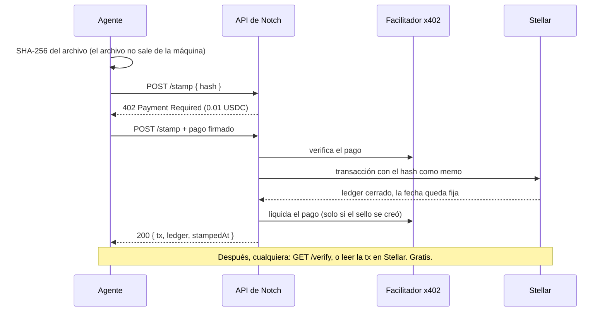
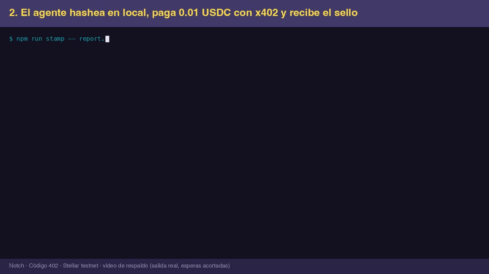

<p align="center">
  
</p>

Español | [English](README.en.md)

# Notch

[](https://github.com/josecadenax/notch/actions/workflows/test.yml)

**Sellos de tiempo de pago por uso para agentes de IA, sobre Stellar.**

Un agente calcula el hash de lo que produjo, paga 0.01 USDC con x402, y Notch ancla ese hash en una transacción de Stellar. Desde ese momento, cualquiera puede comprobar gratis que el documento existía a más tardar en esa fecha.

**Track:** API de pago (x402) · Código 402 · BAF México × Programa de Embajadores de Stellar · Stellar testnet (dinero de prueba, sin valor real)

## El problema

Los agentes ya escriben informes, contratos y conjuntos de datos, y a veces cobran por ellos. Cuando alguien pregunta "¿esto existía antes de la fecha límite?" o "¿se modificó después?", la única evidencia son los registros del propio agente, que controla la misma parte.

Un agente además no tiene cuenta, tarjeta ni contrato con un proveedor de sellos de tiempo. Lo que sí puede hacer es pagar un centavo por llamada, y por eso Notch cobra con x402: sin registro, sin llave de API y sin suscripción.

## Cómo lo resuelve Notch



- **Solo viaja el hash.** El documento nunca sale de la máquina.
- **La fecha es la de Stellar**, la hora de cierre del ledger, no el reloj del servidor.
- **Verificar es gratis** y no requiere a Notch: el memo de la transacción se lee en cualquier explorador.
- **Solo pagas por sellos que existen.** Un sello fallido nunca se cobra.

## Demo en video

[](https://github.com/josecadenax/notch/blob/main/docs/assets/demo/notch-demo-backup.mp4)

Pulsa la imagen para ver el video (1:23, sin audio). Es una animación hecha con la salida real de una ejecución en Stellar testnet, con las esperas acortadas. Los hashes que aparecen se pueden abrir en Stellar Expert.

## Cómo correrlo

Requiere Node 22 o superior. El código vive en [`partes/josecadenax`](partes/josecadenax/README.md).

```
npm install
npm run setup:accounts           # cuentas de testnet, las llaves se guardan en .env
npm start                        # API en http://localhost:3001
npm run stamp -- archivo.pdf     # en otra terminal: calcula el hash, paga y sella
npm run verify -- archivo.pdf <tx>  # comprueba un archivo contra un sello
npm test                         # 21 pruebas
```

## Documentación

Los documentos técnicos están en inglés:

- [Arquitectura](docs/architecture.md): piezas, contrato de la API, qué queda en la cadena, errores y cobros.
- [Guía de la demo](docs/demo.md): el guion de 5 minutos y los comandos exactos.

## Hashes de prueba

Una ejecución real en Stellar testnet:

- Pago de 0.01 USDC (x402): [`15ae64c6…43bd`](https://stellar.expert/explorer/testnet/tx/15ae64c6e6a6bca9ae3775ca4971f0d5f7d6d89dfcd6ec9c2ceadd778e2743bd)
- Sello, con el hash del archivo en su memo: [`980e4423…1bc0`](https://stellar.expert/explorer/testnet/tx/980e4423e8a7476d899aed94d7d4220f5071ee45bdaa939a0f7c04a76cfc1bc0)

## Equipo y partes

- [josecadenax](https://github.com/josecadenax): [su parte](partes/josecadenax/README.md)
