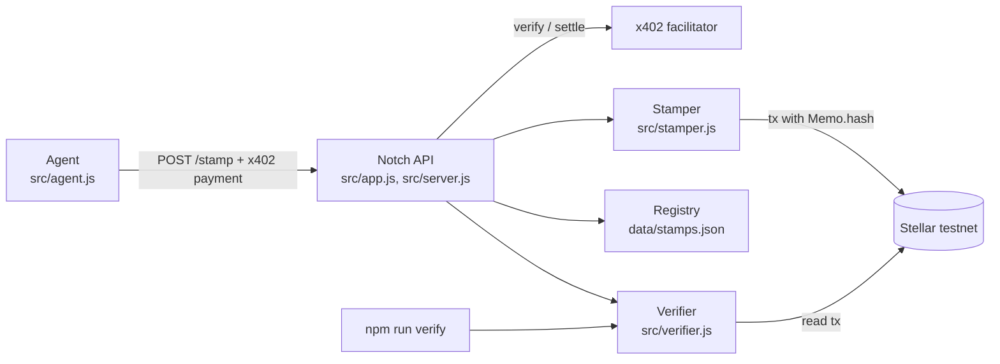

# Architecture

## Pieces

| Piece | File | Job |
|---|---|---|
| Agent | `src/agent.js` | Hashes a file locally, checks the price, balance and spending cap, pays once with x402 |
| API | `src/app.js` | Routes and error semantics. Receives its dependencies, so tests run it without a network |
| Server | `src/server.js` | Wires the real pieces: x402 middleware, stamper, file registry |
| Stamper | `src/stamper.js` | Builds, signs and submits the stamp transaction, one at a time |
| Verifier | `src/verifier.js` | Reads a transaction from Horizon and compares its memo with a hash |
| Registry | `src/registry.js` | Index of stamped hashes, so a hash is never charged twice. It can be rebuilt from the chain |
| Setup | `scripts/setup-accounts.js` | Creates and funds the testnet accounts |

No custom smart contract is used. The only Soroban contract involved is the USDC asset contract, which x402 uses to move the payment.

## Accounts

| Account | Needs | The server keeps |
|---|---|---|
| Payee | USDC trustline | Public key only: it cannot move the earnings |
| Stamper | A little XLM for fees | Secret key |
| Agent | USDC and XLM | Nothing, it belongs to the client |

## API contract

| Endpoint | Cost | Answers |
|---|---|---|
| `GET /` | free | Service info |
| `POST /stamp` body `{ hash }` | 0.01 USDC | `200` stamped, `400` invalid hash, `402` payment required, `409` already stamped, `502` Stellar unreachable |
| `GET /stamp/:hash` | free | `200` stamp, `404` unknown |
| `GET /verify?hash=&tx=` | free | `200` valid, `422` invalid with reasons, `502` Stellar unreachable |

`hash` is a SHA-256 digest as 64 lowercase hex characters. `tx` is a Stellar transaction hash.

## What a stamp is

A stamp is a normal Stellar transaction from the stamper account. Its operation is a payment of 1 stroop (0.0000001 XLM) from the account to itself, and its memo is `Memo.hash(<document hash>)`, which holds exactly 32 bytes. The fee is 0.00001 XLM. The operation moves nothing of value: it only gives the transaction something valid to do.

## What is on chain and what is not

| On chain | Not on chain |
|---|---|
| The document hash | The document, its name and its author |
| The date (ledger close time) | Which agent asked for the stamp |
| The stamper account | The link between a payment and its stamp (x402 payments cannot carry a memo) |

The hash is public and permanent. A short or guessable document can be recovered by trying candidates, so add a random salt before hashing. Testnet can be reset: a stamp is as durable as the network it lives on.

## Errors and charges

x402 verifies the payment first, runs the handler, and settles only if the handler answered below 400. That is what decides who pays:

| Case | Answer | Charged |
|---|---|---|
| Stamp created | 200 | Yes |
| Invalid hash | 400 | No |
| Hash already stamped | 409 | No |
| Stellar unreachable or rejects the transaction | 502 | No |
| Settlement fails after the stamp exists | 402 | No, but a stamp exists. Accepted risk in the demo |

The agent adds its own guards: a spending cap per payment (`SPEND_CAP`), a balance check before signing, retries only while the API is unreachable and never after paying.

## Verification

Anyone can verify without trusting Notch: read the transaction on Stellar and compare its memo with the SHA-256 of the file. `verifyStamp` automates this and also reports whether the stamper account is Notch's (`issuedByNotch`), because any account can write a hash memo.

## Known limits

- A stamp proves a document existed no later than its date. It does not prove who wrote it or that it is true.
- One transaction per stamp. Batching hashes in a Merkle tree would lower the cost and is a natural next step.
- The registry is a JSON file, enough for one server.
